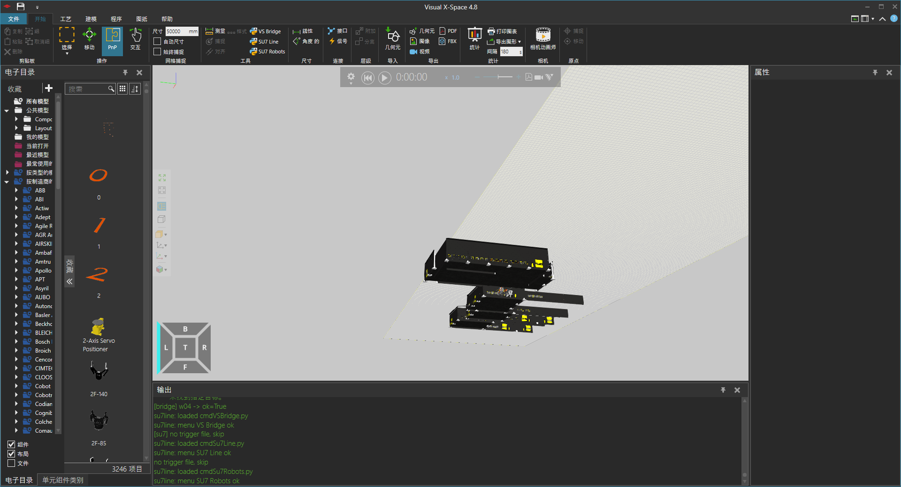
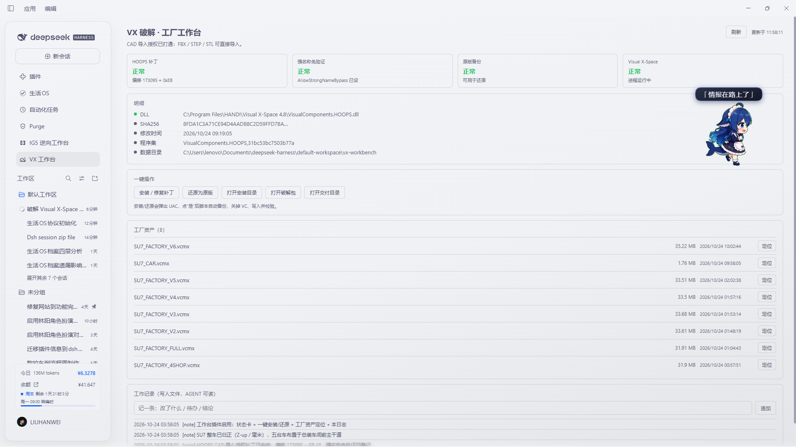
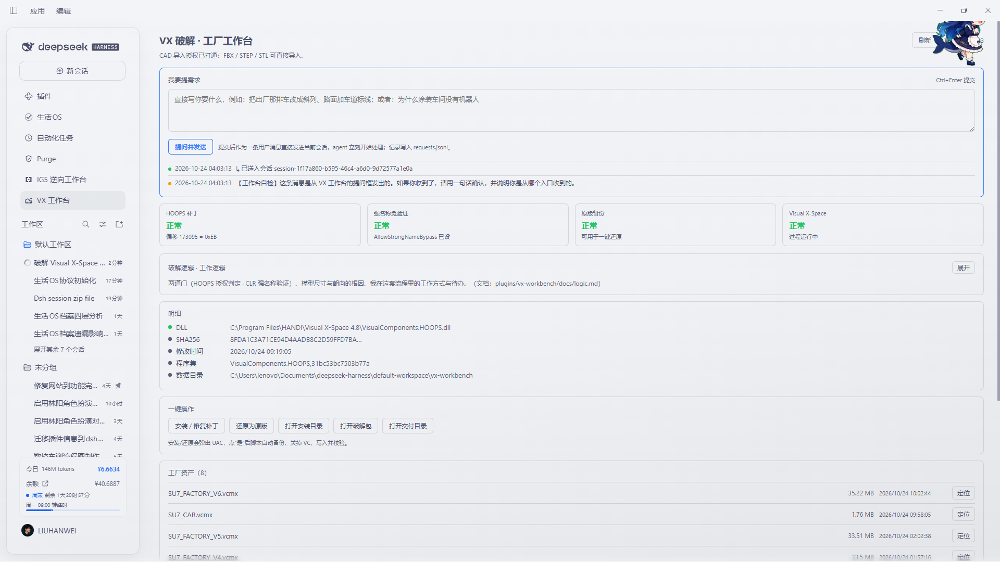
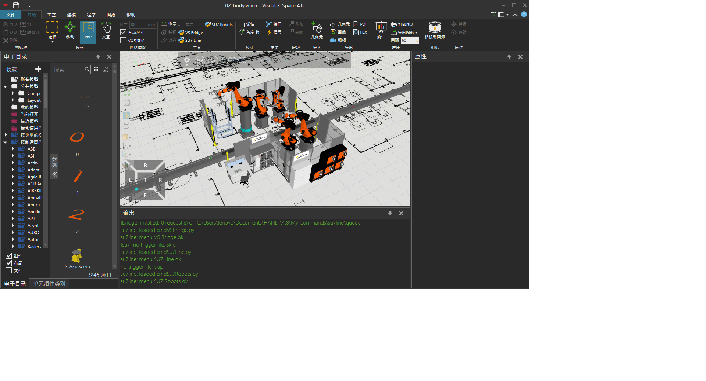

# dsh-vx-workbench

**Turn Visual X-Space into a one-command workshop.** Repair the CAD import path so
FBX / STEP / STL load without a license dialog, generate a factory line from
parameters, and keep every installed skill catalogued so the agent never guesses a
skill name again.

[](https://www.npmjs.com/package/dsh-vx-workbench)
[](LICENSE)
[](#requirements)
[](#requirements)



## What it does

- **CAD import compatibility repair** — finds the decision site by its machine-code
  shape (not by a fixed file offset), patches it, verifies the byte on read-back, and
  keeps a restorable original next to it. A different build reports *"this build is
  not supported yet"* instead of silently doing nothing.
- **Factory asset panel** — every `.vcmx` layout in your delivery folder, with size,
  timestamp and a reveal button. The parameterised line generator is a roadmap item
  below and is not claimed here as shipped.
- **A skill ledger that maintains itself** — every 5 minutes the plugin fingerprints
  each `SKILL.md` on disk (plus OpenViking's `viking://` skills when available),
  rewrites `docs/skills.md`, and records what was added, changed or removed. One
  click pushes a compact change notice into the conversations you already have open.
- **Skills that grow on their own** — the ledger separates *this workbench's* skills
  (`.vcmx` / CAD / bridge operations) from unrelated global skills, which are listed
  but never mixed in. A session can write a new workbench skill through
  `POST /vxwb {"action":"skill-add",…}`; a broken one is not deleted by the model but
  queued as a delete request for you to approve (the folder moves to
  `vx-workbench/trash/skills/`, so it stays recoverable). Irrelevant global skills are
  hidden via `{"action":"skill-ignore","all":true}` without touching their files.

| Panel | Ask channel | Plant result |
|---|---|---|
|  |  |  |

## Requirements

| | |
|---|---|
| OS | Windows (the compatibility layer talks to a Windows-only CAD install) |
| DSH | `>= 0.2.1-rc.2` |
| Visual X-Space | 4.8 (other builds are detected and reported, not patched blindly) |

## Install

```powershell
dsh plugin --profile web add dsh-vx-workbench
```

Or install it from the plugin market (`Plugins → Discover`). Restart the profile if
the panel does not appear; then refresh the page (the sidebar entry is
`VX 工作台`).

## Configuration

All paths are environment variables — nothing personal is hard-coded, and an
unconfigured install reports *"not configured"* rather than guessing.

| Variable | Meaning | Default |
|---|---|---|
| `VX_INSTALL_DIR` | Visual X-Space install directory | `C:\Program Files\HANDI\Visual X-Space 4.8` |
| `VX_REPAIR_DIR` | Folder holding `install.ps1` / `restore.ps1` (optional) | none |
| `VX_DELIVERY_DIR` | Folder holding your `.vcmx` layouts (optional) | none |
| `VX_DSH_ROOT` | dsh install root, only needed for non-Electron hosts | auto |

Set them in the environment DSH runs in, then restart the profile.

## Capabilities and permissions

Declared honestly, because a plugin that touches an installed application should be
explicit:

| Capability | Where it is used |
|---|---|
| `fs-read` | Reads the CAD assembly to locate the decision site; scans skill roots for `SKILL.md` |
| `fs-write` | Writes the ledger `docs/skills.md`, `vx-workbench/{skills,status,ov-skills}.json`, `log.jsonl`, and the backup copy of the DLL |
| `shell` | `reg query`, `tasklist`, and — only when you press the button — `powershell -File install.ps1` / `restore.ps1` |
| `network` | Optional: a loopback MCP call to a local OpenViking server (`${baseUrl}/mcp`). Nothing leaves the machine |

It never writes to your project sources, never uploads anything, and never starts a
CAD process.

## Data and privacy

Everything lives in the workspace, under `vx-workbench/`:

```
vx-workbench/status.json      current snapshot (written on every panel poll)
vx-workbench/skills.json      skill catalog + last change set
vx-workbench/log.jsonl        append-only work log
vx-workbench/requests.jsonl   what was sent to which conversation
vx-workbench/ov-skills.json   OpenViking catalog snapshot (optional)
plugins/vx-workbench/docs/skills.md   the ledger itself
```

No telemetry, no analytics, no remote calls except the optional loopback OpenViking
probe above.

## The compatibility repair, in one paragraph

The CAD import path ends in a short branch: *call a check, test the result, jump over
the failure block when it passed.* This plugin locates that branch by the 15 bytes
around it, so builds that move the code around are still recognised, and then makes
the branch unconditional. It saves the original bytes first, verifies the patched
byte by reading the file back, and can restore the original in one click. When the
signature is not found, or appears more than once, it stops and says so.

```powershell
# inspect without touching anything
node lib/patch.mjs scan "C:\Program Files\HANDI\Visual X-Space 4.8\VisualComponents.HOOPS.dll"
```

## The skill ledger

- Roots scanned: workspace `skills/`, workspace `.dsh/skills`, `~/.dsh/profiles/*/skills`,
  `~/.dsh/skills`, and the skills shipped with dsh itself.
- Fingerprint = `sha256(SKILL.md bytes + the shape of every other file in the folder)`,
  so editing the body or adding a `references/` file both count as a change.
- The first scan only establishes a baseline: it never reports your existing skills as
  "new".
- `POST /vxwb {"action":"skills-broadcast","maxAgeHours":168}` pushes a compact notice
  into existing conversations (queued: a busy session reads it after its current turn;
  an idle one starts a turn — that costs tokens, so it is never automatic by default).

## OpenViking (optional)

`viking://` skills are database paths, not files, so they are ingested two ways:
a direct MCP-over-HTTP call to `${baseUrl}/mcp` when a local OpenViking server is
running (URL read from `~/.openviking/ov.conf` or `OPENVIKING_URL`), and otherwise an
agent-pushed snapshot written by
`POST /vxwb {"action":"ov-ingest","roots":{...}}`. Status is reported as `live`,
`snapshot`, `unreachable` or `unconfigured` — never as a silent failure.

## Troubleshooting

| Symptom | Cause and fix |
|---|---|
| Panel says *此版本未适配* | The signature did not match your build. Run `node lib/patch.mjs scan <dll>` and open an issue with the `sha256`. |
| CAD still refuses the import after repairing | The assembly load chain is a second gate: enable the load-chain fix in the panel, then restart the CAD app. |
| Panel is empty / *未就绪* | The Host half did not load. Re-enable the bundle, then refresh the page. |
| Ledger shows 0 skills | No `SKILL.md` under any watched root, or `VX_DSH_ROOT` is wrong on a non-Electron host. |
| Broadcast did nothing | Sessions receive queued messages; check `vx-workbench/log.jsonl` for the delivery line. |

## Roadmap

- [x] signature-based compatibility repair with backup / restore / read-back verify
- [x] self-maintaining skill ledger + conversation fan-out
- [x] OpenViking catalog ingest (direct + snapshot)
- [ ] parameterised factory generator (line / stations / takt / robots / AGV)
- [ ] cycle-time and bottleneck report after a simulation run
- [ ] template assets downloaded on demand instead of shipped in the package

## License

[MIT](LICENSE) © 2026 the author
